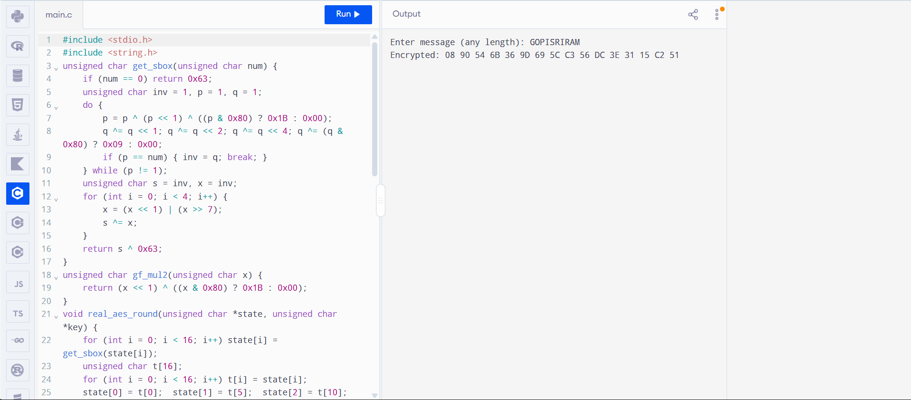

# EX-8-ADVANCED-ENCRYPTION-STANDARD ALGORITHM
# Aim:
To use Advanced Encryption Standard (AES) Algorithm for a practical application like URL Encryption.

# ALGORITHM:
AES is based on a design principle known as a substitution–permutation.
AES does not use a Feistel network like DES, it uses variant of Rijndael.
It has a fixed block size of 128 bits, and a key size of 128, 192, or 256 bits.
AES operates on a 4 × 4 column-major order array of bytes, termed the state
# PROGRAM:

```

#include <stdio.h>
#include <string.h>
unsigned char get_sbox(unsigned char num) {
    if (num == 0) return 0x63;
    unsigned char inv = 1, p = 1, q = 1;
    do {
        p = p ^ (p << 1) ^ ((p & 0x80) ? 0x1B : 0x00);
        q ^= q << 1; q ^= q << 2; q ^= q << 4; q ^= (q & 0x80) ? 0x09 : 0x00;
        if (p == num) { inv = q; break; }
    } while (p != 1);
    unsigned char s = inv, x = inv;
    for (int i = 0; i < 4; i++) {
        x = (x << 1) | (x >> 7);
        s ^= x;
    }
    return s ^ 0x63;
}
unsigned char gf_mul2(unsigned char x) {
    return (x << 1) ^ ((x & 0x80) ? 0x1B : 0x00);
}
void real_aes_round(unsigned char *state, unsigned char *key) {
    for (int i = 0; i < 16; i++) state[i] = get_sbox(state[i]);
    unsigned char t[16];
    for (int i = 0; i < 16; i++) t[i] = state[i];
    state[0] = t[0];  state[1] = t[5];  state[2] = t[10]; state[3] = t[15];
    state[4] = t[4];  state[5] = t[9];  state[6] = t[14]; state[7] = t[3];
    state[8] = t[8];  state[9] = t[13]; state[10] = t[2];  state[11] = t[7];
    state[12] = t[12]; state[13] = t[1];  state[14] = t[6];  state[15] = t[11];
    for (int i = 0; i < 4; i++) {
        int b = i * 4;
        unsigned char s0 = state[b], s1 = state[b+1], s2 = state[b+2], s3 = state[b+3];
        state[b]   = gf_mul2(s0) ^ (gf_mul2(s1) ^ s1) ^ s2 ^ s3;
        state[b+1] = s0 ^ gf_mul2(s1) ^ (gf_mul2(s2) ^ s2) ^ s3;
        state[b+2] = s0 ^ s1 ^ gf_mul2(s2) ^ (gf_mul2(s3) ^ s3);
        state[b+3] = (gf_mul2(s0) ^ s0) ^ s1 ^ s2 ^ gf_mul2(s3);
    }
    for (int i = 0; i < 16; i++) state[i] ^= key[i];
}
int main() {
    char msg[100];
    unsigned char block[16];
    unsigned char key[17] = "SECRET_ROUND_KEY";
    printf("Enter message (any length): ");
    fgets(msg, sizeof(msg), stdin);
    msg[strcspn(msg, "\n")] = 0;
    int len = strlen(msg);
    int padded_len = ((len + 15) / 16) * 16; 
    printf("Encrypted: ");
    for (int b = 0; b < padded_len; b += 16) {
        for (int i = 0; i < 16; i++) {
            if ((b + i) < len) block[i] = msg[b + i];
            else block[i] = ' '; 
        }
        real_aes_round(block, key);
        for (int i = 0; i < 16; i++) printf("%02X ", block[i]);
    }
    printf("\n");
    return 0;
}

```

# OUTPUT:



# RESULT:

Thus, the Advanced Encryption Standard (AES) Algorithm was successfully implemented and verified
